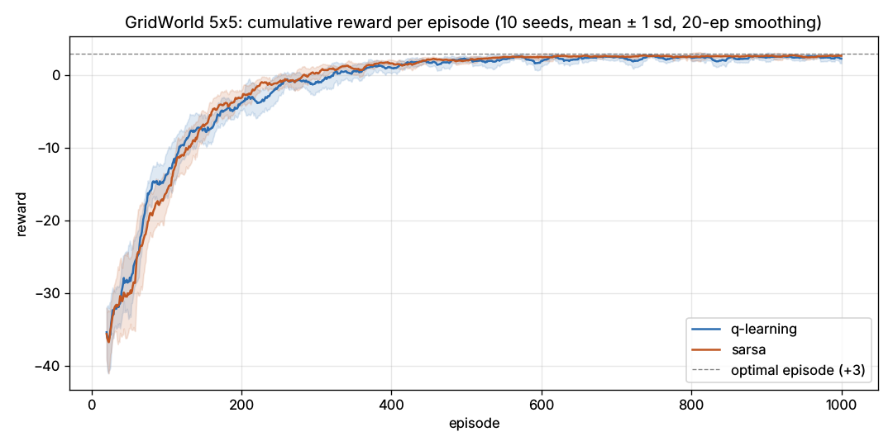

# Reinforcement Learning Lab

Q-learning and SARSA written from scratch in NumPy on a 5×5 GridWorld. Over 10 seeds, both learn the
optimal 8-step path every time.

[](https://github.com/VenkataVinesh/Reinforcement-Learning-Lab/actions/workflows/ci.yml)




## Quick start

```bash
git clone https://github.com/VenkataVinesh/Reinforcement-Learning-Lab.git
cd Reinforcement-Learning-Lab
pip install -r requirements.txt
python train.py            # 10 seeds x 1000 episodes for each agent, prints the table, writes reward_curve.png
pip install -r requirements-dev.txt && pytest -q
```

## How it works

| | |
|---|---|
| Environment (`gridworld.py`) | 5×5 grid, start `(0,0)`, goal `(4,4)` worth +10, pit `(2,2)` worth −10, −1 per step, walls block movement |
| Behaviour policy | ε-greedy with random tie-breaking. ε decays from 1.0 by ×0.995 per episode to a floor of 0.05 |
| Update (`agents.py`) | `Q(s,a) += α [target − Q(s,a)]` with α = 0.1, γ = 0.95 |
| Q-learning target | `r + γ max_a' Q(s', a')` (off-policy: bootstraps from the greedy action) |
| SARSA target | `r + γ Q(s', a')`, where `a'` is the action actually taken next (on-policy) |

Both agents share the environment, the seeds and the schedule, so the only thing that differs is the
bootstrap target. The tests check this directly (`tests/test_agents.py`).

## Results

`python train.py` (10 seeds, 1,000 episodes each):

| Agent | Mean reward, last 100 episodes | Greedy policy reaches goal | Greedy path is the optimal 8 steps |
|---|---:|---:|---:|
| Q-learning | 2.45 ± 0.18 | 10/10 | 10/10 |
| SARSA | 2.60 ± 0.17 | 10/10 | 10/10 |

An optimal episode scores +3 (7 steps at −1, then +10). Training rewards stay just below that
because the behaviour policy still explores 5% of the time. SARSA scores slightly higher during
training because it learns the value of the policy it actually follows, exploration included. The
gap is about one standard deviation, so on a grid this small it is a tendency, not a finding.

## Limitations

- A 25-state tabular problem: it shows the update rules, not anything about scale. No function
  approximation.
- The pit sits off the optimal route, so the classic "cliff-walking" contrast (SARSA choosing a safer
  path) does not show up here.
- Hyperparameters were not tuned. These are textbook defaults.

## Project layout

```
gridworld.py        environment
agents.py           epsilon-greedy, Q-learning and SARSA targets, training loop, greedy rollout
train.py            multi-seed comparison and plot
tests/              pytest: environment dynamics, targets, reproducibility, convergence
```

## License

MIT, see [LICENSE](LICENSE).
